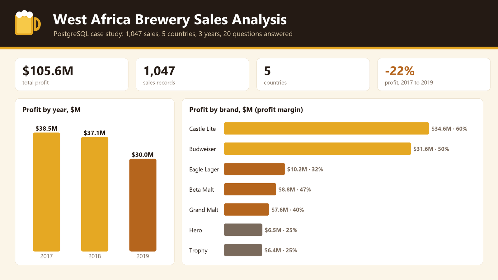
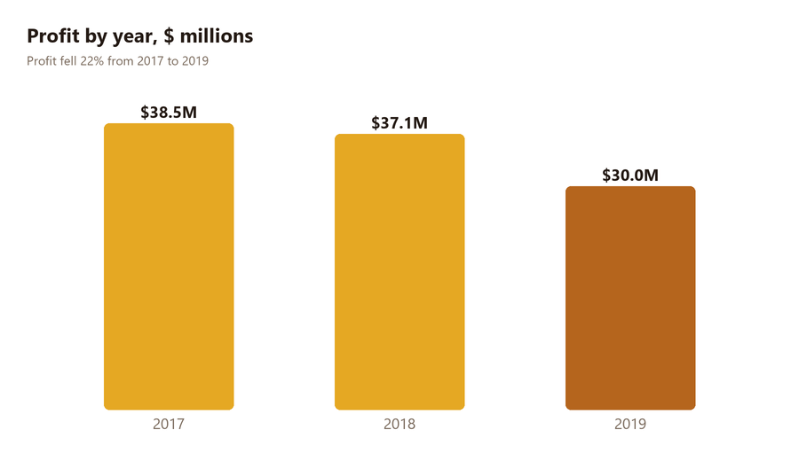
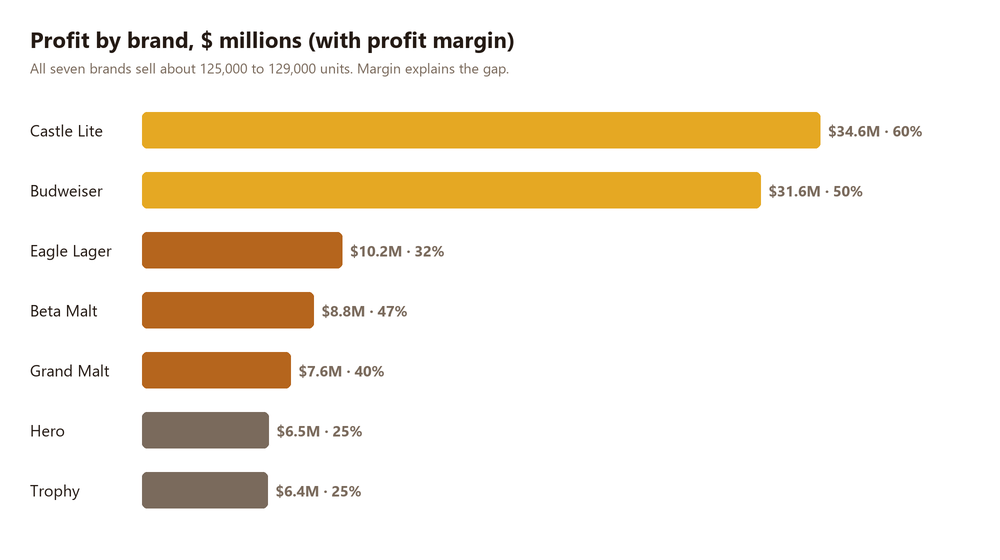
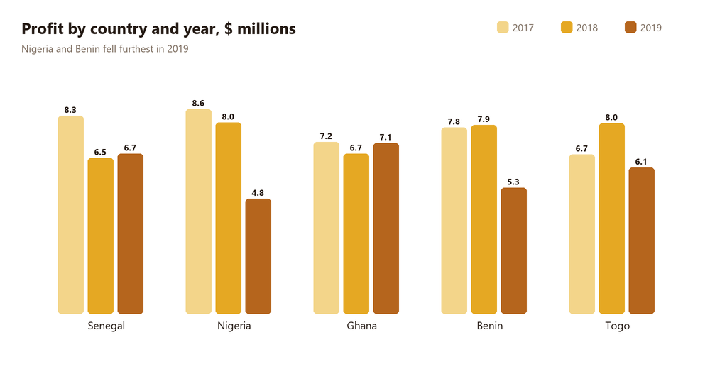

# West Africa Brewery Sales Analysis

**Where does a West African brewer make its profit, and why did it fall in 2019?**

A PostgreSQL case study on 1,047 beer and malt sales across Nigeria, Ghana, Benin, Togo and Senegal from 2017 to 2019. Twenty business questions on profit, brands and countries are answered in SQL, checked on a real PostgreSQL 13 database, and turned into insights and recommendations.



## Quick links

- 🗄️ [Analysis queries (20 questions)](sql/02_analysis.sql)
- 🧱 [Schema and data load](sql/01_schema_and_load.sql)
- 📋 [Answers to all 20 questions](docs/results.md)
- 📁 [The dataset (CSV)](data/breweries.csv), which GitHub previews as a table

---

## Table of Contents

- [About the project](#about-the-project)
- [Headline findings](#headline-findings)
- [Charts](#charts)
- [Repository structure](#repository-structure)
- [The data](#the-data)
- [Run it locally](#run-it-locally)
- [Key insights](#key-insights)
- [Recommendations](#recommendations)
- [Answers at a glance](#answers-at-a-glance)
- [What changed from the first version](#what-changed-from-the-first-version)
- [Limitations](#limitations)
- [License](#license)

---

## About the project

The brief asks for analysis of three years of brewery data to help maximise profit. It has three sections: profit analysis (eight questions), brand analysis (nine) and country analysis (three).

The territories used throughout are:

- **Anglophone:** Nigeria and Ghana
- **Francophone:** Benin, Togo and Senegal
- **Beers:** Budweiser, Castle Lite, Eagle Lager and Trophy
- **Malts:** Beta Malt, Grand Malt and Hero

This began as a group assignment on a fellowship SQL module. This version is my own rework: I ran every query against the data, found and fixed several that answered a different question from the one asked, and wrote up what the numbers mean.

---

## Headline findings

| Metric | Value | Note |
|---|---|---|
| Total profit, 2017 to 2019 | **$105.6M** | 1,047 sales across five countries |
| Profit trend | **-22%** | $38.5M in 2017, $37.1M in 2018, $30.0M in 2019 |
| Francophone vs anglophone | **$63.2M vs $42.4M** | 60% and 40%, but three countries against two |
| Top country in 2019 | **Ghana** | $7.1M, while Nigeria fell to $4.8M |
| Two brands, 63% of profit | **Castle Lite and Budweiser** | $34.6M and $31.6M |
| Weakest month | **February 2019** | $1.4M, 4.55% of that year's profit |

---

## Charts







---

## Repository structure

```
west-africa-brewery-sql-analysis/
│
├── README.md                    This file
├── LICENSE                      MIT
├── CONTRIBUTING.md              Contribution guidelines
├── .gitignore
├── .gitattributes
│
├── sql/
│   ├── 01_schema_and_load.sql   Creates the table and loads the CSV
│   └── 02_analysis.sql          The 20 analysis queries, with notes on each fix
│
├── data/
│   └── breweries.csv            1,047 sales records
│
└── docs/
    ├── results.md               The answer to every question
    ├── cover.png                Cover image
    └── charts/                  Chart images used in this README
```

---

## The data

One table, `breweries`, with one row per sale.

| Column | Type | Description |
|---|---|---|
| `sales_id` | Integer | Unique sale number (10101 onwards) |
| `sales_rep` | Text | Sales representative's surname (11 reps) |
| `brands` | Text | One of 7 brands: 4 beers and 3 malts |
| `plant_cost` | Decimal | Production cost of one unit |
| `unit_price` | Decimal | Selling price of one unit |
| `quantity` | Integer | Units sold |
| `costs` | Decimal | Despite its name, this equals `quantity × unit_price`, so it is sales revenue |
| `profit` | Decimal | `quantity × (unit_price − plant_cost)` |
| `countries` | Text | Nigeria, Ghana, Benin, Togo or Senegal |
| `region` | Text | Sales region inside the country (six in Nigeria) |
| `months` | Text | Month name |
| `years` | Integer | 2017, 2018 or 2019 |

I checked the arithmetic on all 1,047 rows: `costs` always equals `quantity × unit_price`, and `profit` always equals `costs − quantity × plant_cost`. No sale made a loss. The smallest profit is $35,000. I removed the email column from the original file, because the analysis does not use it.

---

## Run it locally

You need PostgreSQL 13 or later.

```bash
createdb brewery
psql -d brewery -f sql/01_schema_and_load.sql
psql -d brewery -f sql/02_analysis.sql
```

Run both commands from the repository root, so the `\copy` path in the first file resolves. Each query in `02_analysis.sql` is numbered (A1 to C3) and matches the headings in [the results](docs/results.md).

---

## Key insights

1. **Profit is falling.** It went from $38.5M in 2017 to $37.1M in 2018 and $30.0M in 2019, down 22%. Units sold fell 16% (317,563 to 267,750), the number of sales fell from 374 to 313, and margin slipped from 44.2% to 42.7%.

2. **Nigeria and Benin drove the 2019 drop.** Nigeria's profit fell from $8.6M in 2017 to $4.8M in 2019 (-44%). Benin fell from $7.9M in 2018 to $5.3M in 2019 (-33%). Ghana held steady and was the top country in 2019 at $7.1M.

3. **The countries are close in size.** Each earned between $20.8M and $21.5M over the three years. Francophone territory leads ($63.2M against $42.4M) only because it has three countries to the anglophone two.

4. **Two brands earn 63% of profit.** Castle Lite ($34.6M) and Budweiser ($31.6M) lead. All seven brands sold about 125,000 to 129,000 units, so margin makes the difference: 60% for Castle Lite, 50% for Budweiser, and only 25% for Hero and Trophy.

5. **Nigeria's two biggest beers fell hardest.** Budweiser units there dropped from 12,027 in 2017 to 5,490 in 2019 (-54%). Castle Lite dropped from 12,835 in 2018 to 3,388 in 2019 (-74%).

6. **There is no steady seasonal pattern, but 2019 was uneven.** Across all three years every month earns $8.6M to $9.1M. In 2019 alone, January was the best month (10.87% of the year) and February the worst (4.55%).

7. **Budweiser has a regional gap in Nigeria.** In 2019 the south-east sold 1,821 units, about double any other region (847 to 990), and the north-central region sold none.

8. **One rep carries a lot.** Jones earned $18.8M, 17.8% of all profit, and is also the top Budweiser rep in Senegal ($1.5M).

---

## Recommendations

| Priority | Action | Expected impact |
|---|---|---|
| High | Investigate the 2019 decline, starting with Nigeria and Benin | Finds whether volume, price or competition caused a 22% fall in profit |
| High | Protect Castle Lite and Budweiser, especially in Nigeria | They earn 63% of profit, and their Nigerian volumes fell 54% to 74% |
| Medium | Run the Budweiser promotion in north-central and south-south Nigeria | These are the regions with no 2019 sales and the lowest 2019 sales |
| Medium | Review price and mix for Hero and Trophy | They sell as many units as the leaders but at a 25% margin |
| Medium | Plan 2020 by country, not by territory | Each country earns about $21M, so the territory gap is a head-count effect |
| Low | Share the top rep's practice | One rep carries 17.8% of profit |

---

## Answers at a glance

| Question | Answer |
|---|---|
| A1. Total profit | $105,587,420 |
| A2. Territory profit | Francophone $63,198,160 and anglophone $42,389,260 |
| A3. Top country in 2019 | Ghana, $7,144,070 |
| A4. Best year | 2017, $38,503,320 |
| A5. Worst month | February 2019, $1,366,880 |
| A6. Minimum profit on a sale in December 2018 | $38,150 |
| A7. Monthly share of 2019 profit | January highest (10.87%), February lowest (4.55%) |
| A8. Top brand in Senegal | Castle Lite, $7,012,980 |
| B1. Top three francophone brands, 2018 and 2019 | Trophy (52,899), Hero (50,846), Eagle Lager (50,630) |
| B2. Top two brands in Ghana | Eagle Lager (25,829), Castle Lite (25,806) |
| B3. Beers consumed in Nigeria | See [results](docs/results.md), B3 |
| B4. Favourite anglophone malt, 2018 and 2019 | Hero, 36,900 units |
| B5. Top brand in Nigeria in 2019 | Budweiser, $1,372,500 |
| B6. Favourite brand in south-south Nigeria | Eagle Lager, 4,551 units |
| B7. Beer consumption in Nigeria | Budweiser leads with 26,153 units |
| B8 and B9. Budweiser by region in Nigeria | See [results](docs/results.md), B8 and B9 |
| C1. Country with highest beer consumption | Nigeria, 103,449 units |
| C2. Top Budweiser rep in Senegal | Jones, $1,479,250 |
| C3. Top country in Q4 2019 | Ghana, $2,045,230 |

---

## What changed from the first version

I ran the original queries against the data and found six that answered a different question from the one asked. Each fix is commented in [`sql/02_analysis.sql`](sql/02_analysis.sql).

| Query | Problem in the first version | Effect on the answer |
|---|---|---|
| A5 | Used `MIN(profit)`, which finds the smallest single sale, not the month with the lowest total | Was December 2017 ($35,000). Now February 2019 ($1,366,880) |
| B1 | Summed profit, grouped by year and country, and returned three rows | Was three Castle Lite rows. Now Trophy, Hero and Eagle Lager |
| B3 | Also filtered on `region = 'west'`, dropping five of Nigeria's six regions | Now covers all of Nigeria |
| B4 | Spelled Nigeria as `Ngeria`, so only Ghana was counted | Was Grand Malt. Now Hero |
| B6 | Also grouped by year, so it returned one year's winner | Was Hero (2019). Now Eagle Lager over all years |
| C1 | Grouped by brand and country and returned the best pair | Same country (Nigeria), now with the true country total |

Other changes: the A7 list is now ordered from highest to lowest, the labelling is consistent (the first version mixed "Section" and "Session"), and queries return only the columns the question needs.

---

## Limitations

- **The data is a teaching dataset.** Sales representatives, prices and volumes follow fixed patterns: each brand has a single price and a single production cost.
- **No losses.** Every sale made a profit, so questions about reducing loss can't be tested.
- **`costs` is mislabelled.** It holds revenue. The real cost of a sale is `quantity × plant_cost`.
- **Profit is the only money measure.** There is no overhead, freight or tax in the data.
- **Beers and malts are my grouping.** The brief uses "beer" and "malt" without defining them, so I used the four brand names that are not malts.

---

## License

Released under the MIT License. See [LICENSE](LICENSE).

---

**Built by Bih Brandy Sango** · Data Scientist and BI Analyst
